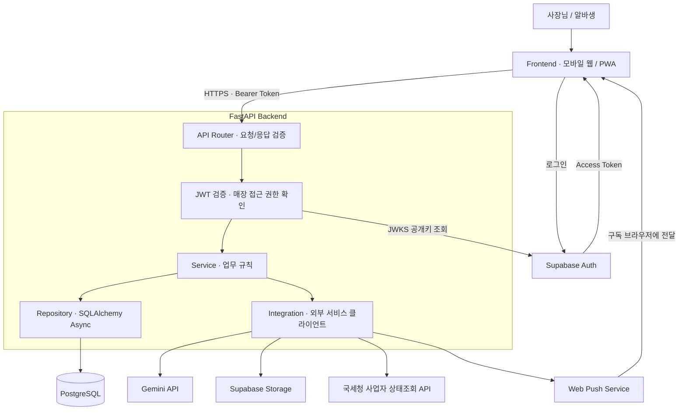
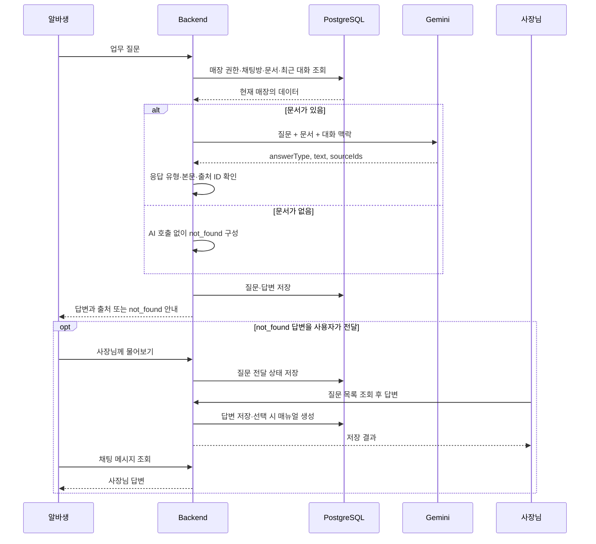

# crewBean — Backend

> 개인 카페 신입 알바생의 든든한 선배, crewBean.
> 매장 매뉴얼과 레시피를 근거로 답하는 AI 사수와 매장 운영을 지원하는 백엔드입니다.

2026 AI 우왕톤 **13팀 F4**의 백엔드 저장소입니다.

- [Backend](https://github.com/woowangthon/WOOWANGTHON_TEAM_13_BE)
- [Frontend](https://github.com/woowangthon/WOOWANGTHON_TEAM_13_FE)

## 1. 프로젝트 개요

개인 카페의 신입 알바생은 레시피, 마감 순서, 손님 응대에 익숙하지 않아 반복해서 질문합니다. 사장님은 같은 내용을 여러 번 설명해야 하고, 구두로 전달한 정보는 다음 근무자에게 남기 어렵습니다.

crewBean은 매장의 업무 지식을 매뉴얼과 레시피로 모으고, AI 사수가 이를 근거로 답하도록 돕습니다. 문서에서 답을 찾지 못하면 알바생이 사장님께 질문을 넘길 수 있습니다. 사장님의 답변은 새 매뉴얼로 저장해 다음 질문의 근거로 활용할 수 있습니다.

### 주요 기능

| 기능 | 설명 |
| --- | --- |
| 사용자·매장 관리 | Supabase 인증, 사업자등록번호 상태조회, 매장 등록, 초대 코드 가입, 구성원 관리 |
| 매뉴얼·레시피 | 매장별 문서 CRUD, 레시피 이미지 관리, 사진 기반 레시피 초안 생성 |
| AI 사수 | 현재 매장의 문서와 최근 대화 맥락을 전달해 답변 생성, 출처 반환 |
| 사장님께 물어보기 | 답을 찾지 못한 질문 전달, 사장님 답변, 답변의 매뉴얼 등록 |
| 인수인계 | AI 체크리스트 초안, 인수인계 작성·조회·체크, 하루 요약 |
| 근무 관리 | 고정 스케줄, 대타 요청·수락·거절, 날짜별 근무 조정 |
| 예상 급여 | 근무표와 시급·공제 설정에 따른 예상 급여 계산 |
| 알림 | 앱 내 알림 조회·읽음 처리, 사장님 질문·답변 Web Push |

### 핵심 사용자 흐름

1. 사장님이 매장을 등록하고 매뉴얼·레시피와 직원 초대 코드를 준비합니다.
2. 알바생이 초대 코드로 가입하고 AI 사수에게 업무를 질문합니다.
3. AI 사수가 매장 문서를 근거로 답하고 출처를 반환합니다.
4. 답을 찾지 못하면 알바생이 질문을 사장님께 넘깁니다.
5. 사장님이 답변하고 필요하면 매뉴얼로 저장해 매장의 업무 지식을 보완합니다.

## 2. 기술 설계 및 선택 (ADR)

### 기술 스택

| 영역 | 기술 |
| --- | --- |
| 언어·API 서버 | Python 3.12 기준, FastAPI, Uvicorn |
| 스키마·환경설정 | Pydantic, pydantic-settings |
| 데이터베이스 | PostgreSQL, SQLAlchemy Async, asyncpg |
| 스키마 변경 관리 | Alembic |
| 인증·파일 저장 | Supabase Auth, PyJWT, Supabase Storage |
| AI·외부 통신 | Gemini API, HTTPX |
| Web Push | pywebpush, VAPID |
| 테스트·린트 | pytest, pytest-asyncio, Ruff |

### ADR 작성 기준

아래 ADR은 현재 구현을 기준으로 정리한 초안입니다. 결정 항목은 코드에서 확인했으며, 대안·선택 이유·트레이드오프는 구현을 바탕으로 재구성했습니다. 실제 도입 당시 팀의 논의와 일치하는지는 제출 전에 확인합니다.

### ADR-001. FastAPI와 비동기 계층 구조

- **배경**: DB 조회와 AI·외부 API 호출을 포함하는 HTTP API가 필요합니다.
- **결정**: FastAPI를 사용하고 API, Service, Repository, Integration 계층을 분리합니다. DB와 HTTP 통신에는 비동기 클라이언트를 사용합니다.
- **대안**: 동기 방식 API 구성, 라우터에 비즈니스·DB 로직을 함께 작성하는 구조.
- **선택 이유**: 외부 응답을 기다리는 흐름을 비동기로 구성하고, 요청 검증·업무 규칙·데이터 접근·외부 호출의 책임을 나누기 위한 선택입니다. Pydantic 스키마와 OpenAPI 문서로 FE와 API 형식을 공유합니다.
- **트레이드오프**: 단순한 CRUD에도 여러 파일이 필요하고, 비동기 세션과 트랜잭션 경계를 관리해야 합니다. 비동기 구성만으로 처리량 증가가 보장되지는 않으며 DB 연결 수와 외부 API 제한도 함께 고려해야 합니다.

### ADR-002. Supabase Auth와 백엔드의 매장 권한 검사

- **배경**: 로그인한 사용자가 여러 매장에 참여할 수 있으며, 매장 소유자와 직원의 권한이 다릅니다.
- **결정**: 로그인은 Supabase Auth를 사용하고, 백엔드는 JWKS 공개키로 access token을 검증합니다. 매장 소유권과 재직 여부는 애플리케이션 데이터로 별도 확인합니다.
- **대안**: 비밀번호·소셜 로그인·토큰 발급을 자체 구현하거나, 토큰의 역할 정보만으로 기능 접근을 결정하는 방식.
- **선택 이유**: 로그인 관리와 매장별 업무 권한을 분리하기 위한 선택입니다. 같은 사용자라도 요청한 매장에 따라 접근 권한을 판단할 수 있습니다.
- **트레이드오프**: Supabase 설정과 공개키 조회에 의존하며, 토큰이 유효해도 매장 권한 검사를 추가로 수행해야 합니다. 공급자 토큰과 Supabase 세션 토큰도 구분해야 합니다.

### ADR-003. 매장 문서를 직접 전달하는 AI 답변과 출처 검증

- **배경**: AI가 다른 매장의 정보를 섞거나, 문서에 없는 업무 지침을 만들어 내는 위험을 줄여야 합니다.
- **결정**: 현재 매장의 매뉴얼·레시피를 조회해 Gemini에 전달하고 구조화된 JSON 답변을 요청합니다. 반환된 출처 ID를 실제 전달 문서와 대조합니다. 유효한 출처나 답변 본문이 없으면 `not_found`로 처리합니다.
- **대안**: 문서 없이 모델의 일반 지식에 의존하는 답변, 임베딩·벡터 검색으로 일부 문서를 검색한 뒤 전달하는 방식.
- **선택 이유**: 현재 구현은 매장 문서를 직접 전달하는 구조여서 문서 등록·수정 결과를 다음 질문에 반영할 수 있습니다. 별도 임베딩 생성과 검색 인덱스 동기화가 필요하지 않습니다.
- **트레이드오프**: 문서가 늘면 입력 토큰과 응답 시간이 증가할 수 있습니다. 출처 ID가 유효하다는 사실만으로 답변 내용 전체가 문서에 부합함을 보장하지는 않습니다. 문서 규모가 커지면 검색·분할 도입을 검토할 수 있습니다.

현재 구현을 임베딩·벡터 검색 기반 RAG로 표기하지 않습니다. `pgvector`가 의존성에 포함되어 있어도 AI 사수의 현재 답변 경로는 매장 문서 직접 전달 방식입니다.

### ADR-004. AI 초안 생성과 확정 저장의 분리

- **배경**: 이미지 해석과 요약에서 누락·오인식이 발생할 수 있으므로 생성 결과를 업무 문서로 확정하기 전에 검토할 수 있어야 합니다.
- **결정**: 레시피·인수인계·매뉴얼 초안은 생성 API에서 바로 저장하지 않습니다. 사용자가 확인·수정한 내용을 저장 API로 등록합니다. 사장님 답변과 매뉴얼을 함께 저장하는 요청은 하나의 트랜잭션으로 처리합니다.
- **대안**: AI 생성 결과를 즉시 DB에 저장하는 방식.
- **선택 이유**: 생성과 확정을 구분해 사용자가 저장할 내용을 통제하도록 하기 위한 선택입니다. 답변과 매뉴얼의 동시 저장은 일부만 반영되는 상태를 방지합니다.
- **트레이드오프**: 생성 후 확인·저장 단계가 추가됩니다. 사용자가 저장하지 않은 초안은 영속 데이터로 남지 않습니다.

### ADR-005. 근무·급여는 규칙 기반으로 처리

- **배경**: 근무표와 급여는 같은 입력에 대해 일관된 결과와 계산 근거를 제공해야 합니다.
- **결정**: 고정 근무, 대타, 날짜별 조정, 매장 휴무를 코드로 처리합니다. 예상 급여는 근무표와 같은 규칙으로 근무 시간을 구하고 시급·공제 설정에 따라 계산합니다.
- **대안**: 근무표 해석과 급여 계산을 LLM에 맡기는 방식.
- **선택 이유**: 계산 결과를 재현하고, 오류가 발생하면 입력과 규칙을 기준으로 확인하기 위한 선택입니다.
- **트레이드오프**: 적용 규칙이 바뀌면 코드와 테스트를 수정해야 합니다. 실제 출퇴근 기록에 따른 확정 급여가 아니며, 공휴일·연장·야간 가산 등 미반영 항목이 있습니다. 응답은 `isEstimate: true`인 예상값으로 제공합니다.

## 3. 아키텍처 다이어그램

### 전체 시스템



Health Check 등 공개 엔드포인트를 제외한 업무 API에서는 인증과 해당 기능의 매장 권한을 확인합니다. PostgreSQL은 애플리케이션 데이터를, Supabase Storage는 이미지 파일을 저장합니다.

### AI 사수와 사장님 답변 흐름



사장님 질문 전달·답변 이벤트의 Web Push는 VAPID 설정과 수신 브라우저의 구독이 필요합니다. 위 다이어그램은 핵심 데이터 흐름을 나타내며 Web Push 전송은 전체 시스템 다이어그램에 표시했습니다.

## 4. 실행 방법

### 사전 준비

- Python 3.12 사용 권장
- Supabase 프로젝트와 접속 가능한 PostgreSQL DB
- Supabase Auth 설정 및 로그인 가능한 테스트 계정
- AI·이미지·사업자 조회·Web Push를 검증하려면 해당 연동 설정

### 설치

```bash
git clone https://github.com/woowangthon/WOOWANGTHON_TEAM_13_BE.git
cd WOOWANGTHON_TEAM_13_BE

python3.12 -m venv .venv
source .venv/bin/activate
python -m pip install --upgrade pip
python -m pip install -r requirements.txt

cp .env.example .env
```

### 환경변수

`.env`의 다음 기본 설정에 실제 값을 입력합니다.

```dotenv
DATABASE_URL=postgresql+asyncpg://<USER>:<PASSWORD>@<HOST>:<PORT>/<DATABASE>
DB_POOL_SIZE=5
DB_MAX_OVERFLOW=0

SUPABASE_URL=https://<PROJECT_REF>.supabase.co
SUPABASE_JWT_ISSUER=https://<PROJECT_REF>.supabase.co/auth/v1
SUPABASE_JWT_AUDIENCE=authenticated
SUPABASE_JWKS_URL=https://<PROJECT_REF>.supabase.co/auth/v1/.well-known/jwks.json

CORS_ORIGINS=http://localhost:5173
```

`<...>`는 실제 프로젝트 값으로 교체합니다. DB 비밀번호에 URL 예약 문자가 있으면 URL 인코딩이 필요합니다. 애플리케이션 DB 연결은 SSL을 요구합니다. 기본 설정만으로 모든 외부 연동 기능을 검증할 수는 없습니다.

| 검증할 기능 | 추가 환경변수 및 준비 |
| --- | --- |
| AI 답변·초안·요약 | `GEMINI_API_KEY`, 계정에서 사용 가능한 `GEMINI_MODEL` 설정. 예제 모델 기본값은 `.env.example` 참고 |
| 이미지 업로드 | `SUPABASE_SECRET_KEY`, 비공개 버킷 `SUPABASE_STORAGE_BUCKET=content-files`, 공개 버킷 `SUPABASE_STORE_PHOTO_BUCKET=store-photos` 생성 |
| 사업자 상태조회 | 공공데이터포털에서 발급받은 `NTS_BUSINESS_API_KEY` |
| Web Push | `VAPID_PUBLIC_KEY`, `VAPID_PRIVATE_KEY`, `VAPID_SUBJECT`; FE의 `VITE_VAPID_PUBLIC_KEY`에 같은 공개키 설정 및 브라우저 알림 구독 |

`.env`, 서버 비밀키, VAPID 비밀키는 저장소에 커밋하거나 FE에 전달하지 않습니다.

### DB 마이그레이션 및 서버 실행

저장소 루트에서 실행합니다.

```bash
alembic upgrade head
uvicorn app.app:app --reload --host 0.0.0.0 --port 8000
```

| 항목 | 주소 |
| --- | --- |
| 서버 | http://localhost:8000 |
| Swagger UI | http://localhost:8000/docs |
| OpenAPI JSON | http://localhost:8000/openapi.json |
| Health Check | http://localhost:8000/api/v1/health/live |

## 5. 실행 결과 확인

### 서버 응답과 스키마 확인

```bash
curl -i http://localhost:8000/api/v1/health/live
```

기대 결과는 HTTP `200`과 다음 JSON입니다.

```json
{"status":"ok"}
```

이 엔드포인트는 서버 응답만 확인하며 DB나 Gemini 연결을 검사하지 않습니다. DB 마이그레이션 상태는 다음 명령으로 확인합니다.

```bash
alembic current
alembic heads
```

현재 revision과 head revision이 일치하는지 확인합니다.

### 인증 및 DB 접근 확인

Supabase 로그인 세션의 access token을 사용합니다. Google·Kakao 공급자의 토큰과 구분합니다.

```bash
curl -i http://localhost:8000/api/v1/users/me \
  -H "Authorization: Bearer <SUPABASE_ACCESS_TOKEN>"
```

- 유효한 토큰: 사용자 정보를 반환합니다. 최초 요청이면 연결된 애플리케이션 사용자를 생성합니다.
- 토큰 없음·검증 실패: HTTP `401`을 반환합니다.

Swagger UI의 `Authorize`에 토큰을 입력해 보호된 API를 확인할 수도 있습니다.

### 핵심 기능 확인 시나리오

사장님과 알바생 테스트 계정을 각각 준비합니다. 요청 본문의 필수 필드와 응답 형식은 실행 중인 서버의 Swagger UI를 기준으로 입력합니다.

| 순서 | 실행 | 확인할 결과 |
| --- | --- | --- |
| 1 | 사장님 계정으로 사업자 상태조회 후 매장 등록 | 본인 인증 결과를 연결한 매장 생성 및 `storeId` 확보 |
| 2 | 매뉴얼 카테고리와 매뉴얼 생성. 예: 제목 `마감 점검`, 본문 `마감 시 냉장고 문이 닫혔는지 확인한다.` | 매뉴얼 목록·상세에 저장한 내용 표시 |
| 3 | 초대 코드 발급 → 알바생 계정으로 코드 확인 및 가입 | 구성원 목록과 알바생의 소속 매장에 반영 |
| 4 | 알바생 채팅방 생성 후 `마감할 때 냉장고는 뭘 확인하나요?` 질문 | `answered` 답변에 등록한 매뉴얼의 출처 ID·제목 포함 |
| 5 | 매뉴얼·레시피가 없는 별도 테스트 매장에서 업무 질문 | AI 호출 없이 `not_found` 안내 반환 |
| 6 | `not_found` 답변을 사장님께 전달 → 사장님 답변 및 `addToManual: true` 저장 | 알바생 채팅에 사장님 답변 표시, 새 매뉴얼 생성 |
| 7 | 생성된 매뉴얼에 해당하는 질문을 다시 전송 | 새 문서가 AI 답변의 근거 문서에 포함되는지 확인 |
| 8 | 알바생 계정으로 사장님 전용 문서 수정 요청 | 권한 거부. 매뉴얼 등 공통 매장 권한 검사에서 구성원은 `403`, 외부 사용자는 `404` |
| 9 | 고정 근무 설정 → 하루 근무 조정 → 달력·예상 급여 조회 | 같은 날짜의 조정된 근무 시간이 달력과 급여 근거에 반영 |

Web Push는 수신 계정의 브라우저 구독을 먼저 등록한 뒤 질문 전달·답변 이벤트로 확인합니다. 앱 내 알림 조회와 브라우저 푸시 수신은 각각 확인합니다.

### 자동 테스트 및 린트

환경변수를 설정한 뒤 저장소 루트에서 실행합니다.

```bash
pytest tests/test_health.py
pytest
ruff check .
```

`tests/test_health.py`는 서버 기본 응답, Health Check, OpenAPI 인증 스키마, CORS를 확인합니다. 전체 테스트와 별도로 위 시나리오를 수행해 실제 DB·인증·외부 서비스 연동도 확인합니다.

## 6. 현재 범위와 제한

- AI 답변은 매장 문서에 근거하도록 구성하고 출처 ID를 검증하지만, 문장 단위의 사실 일치를 자동으로 보장하지는 않습니다.
- AI 생성 초안은 사용자 확인 후 별도로 저장합니다.
- 근무 관리는 현재 고정 근무·대타·하루 조정 방식입니다. 과거 README의 근무 가능 시간 제출·추천 스케줄 API는 현재 라우터와 일치하지 않아 이 문서에서는 제공 기능으로 포함하지 않았습니다.
- 급여는 실제 출퇴근 기록에 따른 확정 금액이 아닌 예상값입니다. 휴게시간 자동 차감과 공휴일·연장·야간 가산은 계산하지 않습니다.
- 외부 API 기능은 유효한 키·권한·버킷·구독 설정이 필요합니다.

## 7. API 및 협업 문서

- 요청·응답 형식과 현재 제공 API: 서버 실행 후 `/docs`
- 환경변수 목록: [`.env.example`](https://github.com/woowangthon/WOOWANGTHON_TEAM_13_BE/blob/main/.env.example)
- 기존 README의 API별 사용 예시와 커밋 규칙은 실제 구현과 대조한 뒤 이 절 아래에 이어 붙일 수 있습니다.
