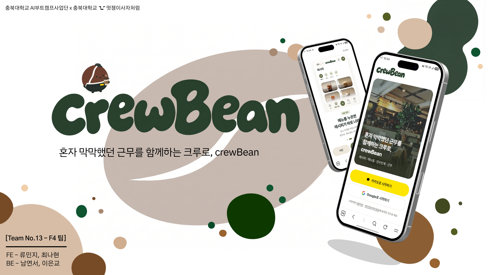
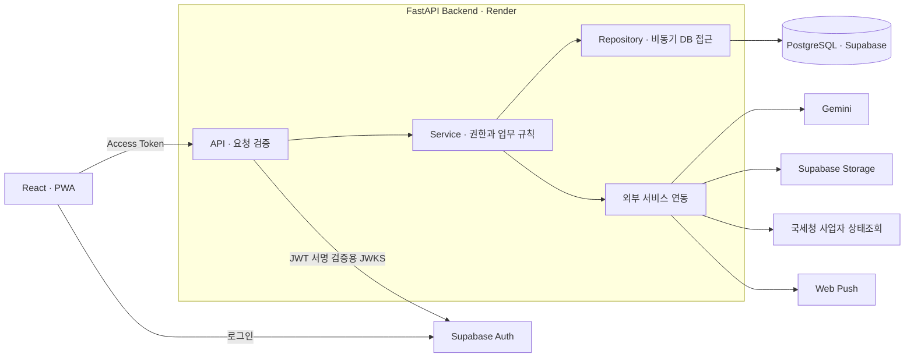

<div align="center">



<br />

개인 카페 신입 알바생에게 **우리 매장 매뉴얼 · 레시피로 답하고**,<br />
모르는 건 **사장님께 넘기는** AI 사수의 백엔드

<sub>2026 AI 우왕톤 · 13팀 F4 · 주제 “AI는 동료가 될 수 있는가”</sub>

<br />

[서비스 열기](https://woowangthon-team-13-fe.vercel.app) &nbsp;·&nbsp;
[시연 영상](https://www.youtube.com/watch?v=tNBlgXNmUDY) &nbsp;·&nbsp;
[Frontend 저장소](https://github.com/woowangthon/WOOWANGTHON_TEAM_13_FE)

</div>

---

## 한눈에 보기

개인 카페의 신입 알바생은 레시피·마감 순서·손님 응대가 헷갈려도 바쁜 사장님께 계속 묻기 어렵습니다. 사장님은 같은 질문에 반복해서 답하고, 구두로 전달한 내용은 다음 근무자에게 남기 어렵습니다.

crewBean은 **매장의 업무 지식을 모으고, AI가 먼저 답하며, 사람이 확인한 지식을 다시 쌓는 흐름**을 만듭니다. 백엔드는 이 과정에서 매장별 데이터와 권한, 답변의 출처, 저장과 계산 규칙을 관리합니다.

| | |
| --- | --- |
| **누구의 문제?** | 계속 묻기 어려운 개인 카페 **신입 알바생**, 같은 질문에 반복해서 답하는 **사장님** |
| **crewBean은?** | 매장 문서를 근거로 답하고 **출처를 표시**, 찾지 못하면 사장님께 질문 전달 |
| **BE의 역할** | 매장별 권한·데이터 관리, AI 응답·출처 검증, 근무·예상 급여 계산, 알림 |
| **사람이 하는 일** | 매장 지식 등록, AI 초안 검토, 미해결 질문 답변과 매뉴얼 저장 결정 |

→ 자세히: [문제 · 해법 · 주요 기능](docs/problem-and-solution.md)

## 핵심 사용 흐름

```text
사장님: 매장 등록 → 매뉴얼·레시피 준비 → 직원 초대 코드 발급
알바생: 초대 코드로 입장 → AI 사수에게 업무 질문
AI 사수: 매장 문서를 근거로 답변 + 출처 표시
         └─ 찾지 못하면 → 알바생이 [사장님께 물어보기]
사장님: 질문에 답변 → 필요하면 매뉴얼로 저장 → 다음 질문의 근거로 활용
```

레시피 사진 해석, 인수인계 체크리스트, 사장님 답변의 매뉴얼 정리는 **초안 생성과 확정 저장을 분리**합니다. 사용자가 내용을 확인·수정한 뒤 저장합니다.

## 주요 기능

| 영역 | 백엔드에서 하는 일 |
| --- | --- |
| **인증 · 매장 · 구성원** | Supabase JWT 검증, 사업자 상태조회, 매장 등록, 초대 코드 가입·퇴사와 구성원 시급·공제 설정 |
| **AI 사수 · 사장님께 물어보기** | 현재 매장의 문서와 최근 대화 맥락으로 답변 생성, 출처 확인, 미해결 질문 전달 및 답변의 매뉴얼 등록 |
| **레시피 · 매뉴얼** | 카테고리·문서 CRUD, 레시피 이미지 업로드·서명 URL 제공, 사진 스캔으로 레시피 초안 생성 |
| **인수인계** | 줄글을 체크리스트 초안으로 변환, 기록 작성·조회·항목 체크, 하루 인수인계 AI 요약 |
| **근무 · 예상 급여** | 고정 근무와 변경 이력, 대타 요청·수락·거절, 하루 조정, 달력과 같은 근무 데이터를 사용한 예상 급여 |
| **알림 · 통계** | 앱 내 알림·읽음 처리·출근 전 인수인계 배너, 질문·답변 Web Push, 주간 AI 답변 통계와 미해결 질문 조회 |

## 기술 설계



**API → Service → Repository / Integration**으로 책임을 나눕니다. 로그인은 FE와 Supabase Auth가 담당하고, BE는 JWT 검증 후 요청한 매장의 소유권·재직 여부를 확인합니다. 업무 데이터는 BE를 거쳐 PostgreSQL에 저장합니다.

| 영역 | 기술과 역할 |
| --- | --- |
| **API · 검증** | Python 3.12, FastAPI, Uvicorn, Pydantic — 비동기 API와 요청·응답 스키마 |
| **DB · 스키마 관리** | PostgreSQL, SQLAlchemy Async, asyncpg, Alembic — 데이터 저장과 마이그레이션 |
| **인증 · 파일** | Supabase Auth, PyJWT, Supabase Storage — 세션 검증과 이미지 저장 |
| **AI · 외부 통신** | Gemini, HTTPX, pywebpush — 답변·초안 생성과 외부 서비스 호출 |
| **품질 · 배포** | pytest, Ruff, mypy, Render — 테스트·정적 검사와 API 서버 배포 |

→ 자세히: [전체 아키텍처 · AI 시퀀스 · 프로젝트 구조](docs/architecture.md)

## 기술 선택과 트레이드오프

| 선택 | 설계 의도와 고려할 점 |
| --- | --- |
| **FastAPI + 비동기 계층 구조** | DB·AI 호출 대기를 비동기로 구성하고 업무 규칙과 외부 연동을 분리합니다. 세션·트랜잭션과 연결 풀 관리는 별도로 필요합니다. |
| **Supabase Auth + 매장 권한 검사** | 로그인 세션 검증과 매장별 업무 권한을 나눕니다. 토큰이 유효해도 해당 매장의 소유자·재직자인지 확인합니다. |
| **매장 문서 직접 전달 + 출처 ID 검증** | 문서 변경을 다음 질문에 반영하며 임베딩 인덱스를 따로 관리하지 않습니다. 문서가 늘면 입력 토큰과 응답 시간도 늘어날 수 있습니다. |
| **AI 초안과 저장 분리** | 사용자가 검토한 내용을 확정합니다. 사장님 답변과 매뉴얼을 함께 저장할 때는 한 트랜잭션으로 처리합니다. |
| **근무·급여의 규칙 기반 계산** | 같은 입력에 일관된 결과와 계산 근거를 제공합니다. 실제 출퇴근 기록에 따른 확정 급여가 아닌 예상값입니다. |

위 내용은 현재 구현의 설계 요약입니다. 배경·대안·선택 이유와 제한은 [ADR 5개](docs/adr.md)에 정리했습니다.

## AI 사수는 어떻게 답하나요?

1. 매장 접근 권한과 본인 채팅방을 확인합니다.
2. **현재 매장의 매뉴얼·레시피**와 최근 대화를 조회합니다. 이전 대화는 질문의 뜻을 파악하는 데 사용합니다.
3. Gemini에 구조화된 JSON 응답을 요청하고, 서버가 답변 유형·본문과 실제 전달한 문서의 출처 ID를 확인합니다.
4. 검증한 질문·답변을 저장하고, 답변과 출처 또는 안내문을 반환합니다.

| 답변 유형 | 처리 |
| --- | --- |
| `answered` | 유효한 출처가 있는 답변과 문서 ID·제목 반환 |
| `not_found` | 근거를 찾지 못했다는 안내. 사용자가 사장님께 질문 전달 가능 |
| `out_of_scope` | 매장 업무와 무관한 질문이라는 안내 |

문서가 없으면 Gemini를 호출하지 않고 `not_found`를 반환합니다. 출처 ID 검증은 답변의 모든 문장이 사실이라는 보장은 아니므로, 미해결 질문은 사람이 답하고 지식을 보완할 수 있게 했습니다.

레시피·인수인계의 해석과 정리는 AI가, **권한 확인·근무 시간·급여 계산은 서버 코드**가 담당합니다.

## 실행 · 확인 방법

```bash
git clone https://github.com/woowangthon/WOOWANGTHON_TEAM_13_BE.git
cd WOOWANGTHON_TEAM_13_BE
python3.12 -m venv .venv
source .venv/bin/activate
python -m pip install -r requirements.txt
cp .env.example .env
# .env에 DB·Supabase 인증 설정 입력 (AI 등은 사용할 기능에 맞춰 추가)
alembic upgrade head
uvicorn app.app:app --reload
```

| 준비할 설정 | 용도 |
| --- | --- |
| DB 연결 URL · Supabase 프로젝트/JWT 설정 | 기본 실행과 인증 API |
| Gemini API 키 · 사용 가능한 모델 | AI 답변·사진 해석·초안·요약 |
| Storage 서버 키 · 버킷 | 레시피·매장 이미지 |
| 국세청 API 키 · VAPID 키 쌍 | 사업자 상태조회 · 브라우저 푸시 |

**API 문서:** [localhost:8000/docs](http://localhost:8000/docs). `Authorize`에 Supabase 세션의 access token을 입력해 보호된 API를 확인합니다.

```bash
curl -i http://localhost:8000/api/v1/health/live
# 기대 결과: HTTP 200, {"status":"ok"}

pytest tests/test_health.py
```

| 확인할 흐름 | 기대 결과 |
| --- | --- |
| 토큰 없이 `GET /api/v1/users/me` | `401`; 유효한 토큰으로는 사용자 정보 반환 |
| 매뉴얼 등록 → 알바생 가입 → 해당 내용 질문 | 답변과 등록한 문서의 출처 반환 |
| 미해결 질문 전달 → 사장님 답변·매뉴얼 저장 | 채팅에 답변 표시, 이후 질문의 근거 문서로 활용 |
| 하루 근무 조정 → 달력·예상 급여 조회 | 조정한 근무 시간이 두 응답의 근거에 반영 |

Health Check는 서버 응답만 확인합니다. 실제 DB·인증·AI·푸시 연동은 계정·키·구독을 준비한 뒤 각 흐름으로 확인합니다. 급여의 미반영 항목과 AI 답변의 한계도 상세 문서에 구분했습니다.

→ 자세히: [환경변수 · 실행 방법](docs/getting-started.md) · [인증 · 핵심 기능 확인 · 한계](docs/verification.md)

## 문서

| 문서 | 내용 |
| --- | --- |
| [문제 · 해법 · 주요 기능](docs/problem-and-solution.md) | 사용자 문제, 핵심 흐름, 사람과 AI의 역할 |
| [기술 설계](docs/architecture.md) | 전체 구성도, AI 처리 흐름, 계층·프로젝트 구조 |
| [ADR](docs/adr.md) | 선택한 기술과 대안, 선택 이유, 트레이드오프 |
| [실행 방법](docs/getting-started.md) | 설치, 환경변수, 마이그레이션, 서버 실행 |
| [확인 방법과 한계](docs/verification.md) | 인증·권한·기능 검증 시나리오, 테스트 명령, 미지원 범위 |

## 팀 F4

| 백엔드 | 담당 |
| --- | --- |
| [이은교 · @euungyo](https://github.com/euungyo) | 인증 · 매장 · 구성원 · 근무 · 푸시 |
| [남연서 · @yeontteo](https://github.com/yeontteo) | AI · 매뉴얼 · 레시피 · 인수인계 · 급여 |

프론트엔드: [류민지](https://github.com/ryu-min-ji) · [최나현](https://github.com/nahyun2). [팀과 협업 방식](https://github.com/woowangthon/WOOWANGTHON_TEAM_13_FE/blob/main/docs/team.md)
