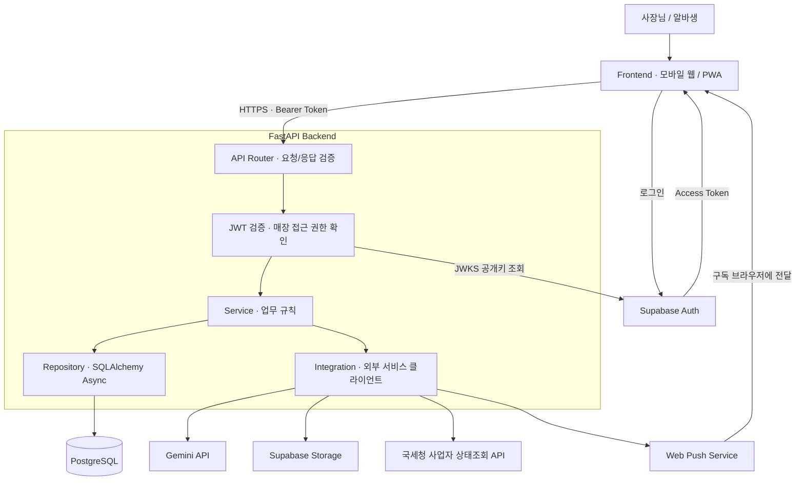
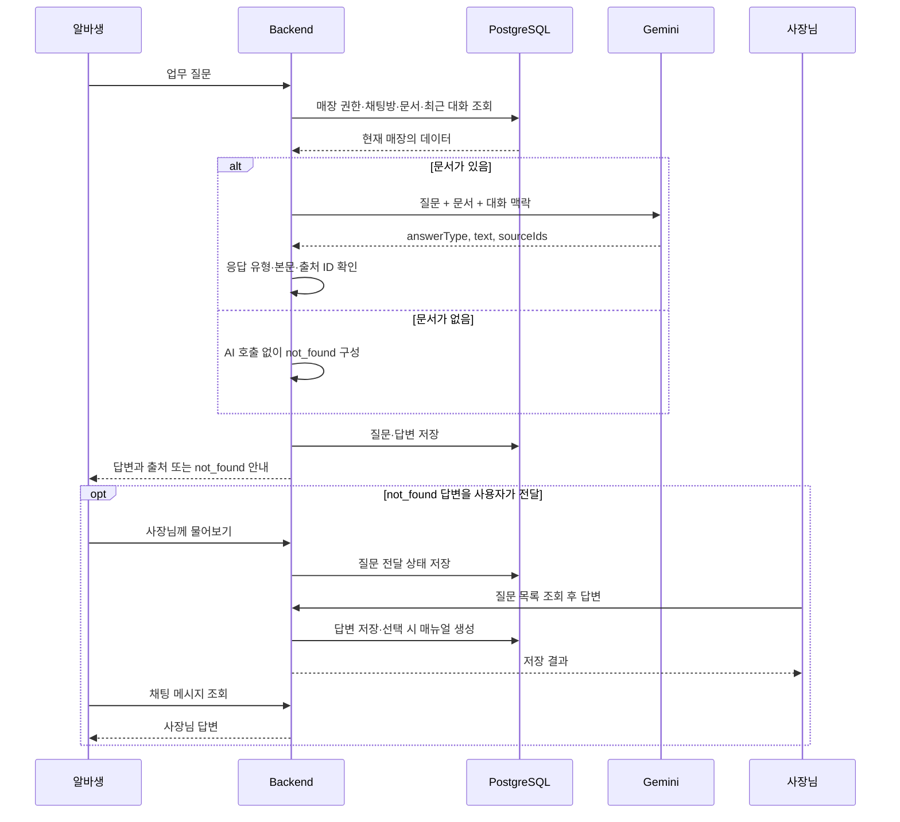

# 기술 설계 · 아키텍처

[README로 돌아가기](../README.md)

## 기술 스택

| 영역 | 기술 |
| --- | --- |
| 언어·API 서버 | Python 3.12 기준, FastAPI, Uvicorn |
| 스키마·환경설정 | Pydantic, pydantic-settings |
| 데이터베이스 | PostgreSQL, SQLAlchemy Async, asyncpg |
| 스키마 변경 관리 | Alembic |
| 인증·파일 저장 | Supabase Auth, PyJWT, Supabase Storage |
| AI·외부 통신 | Gemini API, HTTPX |
| Web Push | pywebpush, VAPID |
| 테스트·린트 | pytest, pytest-asyncio, Ruff |

## 시스템과 데이터 흐름

### 전체 시스템



Health Check 등 공개 엔드포인트를 제외한 업무 API에서는 인증과 해당 기능의 매장 권한을 확인합니다. PostgreSQL은 애플리케이션 데이터를, Supabase Storage는 이미지 파일을 저장합니다.

### AI 사수와 사장님 답변 흐름



사장님 질문 전달·답변 이벤트의 Web Push는 VAPID 설정과 수신 브라우저의 구독이 필요합니다. 위 다이어그램은 핵심 데이터 흐름을 나타내며 Web Push 전송은 전체 시스템 다이어그램에 표시했습니다.

### 계층별 책임

| 계층 | 역할 |
| --- | --- |
| API / Schema | 요청·응답 검증, 의존성 주입, HTTP 응답 구성 |
| Service | 매장 권한, 업무 규칙, AI 응답 검증, 근무·급여 계산 |
| Repository / Model | SQLAlchemy 모델, DB 조회·저장 및 트랜잭션 |
| Integration | Gemini, Storage, 사업자 조회, Web Push 호출 |

### 프로젝트 구조

```text
app/
├── app.py          # FastAPI 진입점 · 미들웨어
├── api/v1/         # 도메인별 엔드포인트
├── core/           # 환경설정 · JWT 인증 · 공통 오류 처리
├── db/             # 비동기 DB 세션 · Base
├── integrations/   # 외부 서비스 클라이언트
├── models/         # SQLAlchemy 모델
├── repositories/   # 데이터 접근
├── schemas/        # Pydantic 요청·응답 스키마
└── services/       # 비즈니스 로직
alembic/versions/   # 스키마 변경 이력
tests/             # API 테스트 · unit/ 단위 테스트
```

### 직접 구현한 부분과 외부 기술

| 직접 구현 | 사용하는 외부 기술 |
| --- | --- |
| 매장·구성원 권한, 초대 코드, 업무 문서·채팅 저장 | FastAPI, SQLAlchemy, PostgreSQL |
| 매장 문서 수집, 프롬프트 구성, 답변 유형·출처 검증 | Gemini의 텍스트·이미지 생성 API |
| 근무 이력·대타·날짜별 조정, 예상 급여 계산 | Python 규칙 기반 코드, 공휴일 정보 라이브러리 |
| JWT 검증 및 사용자 매핑 | Supabase Auth, PyJWT |
| 파일 검증·저장 경로·URL 발급, 구독 및 알림 이벤트 처리 | Supabase Storage, 브라우저 Web Push |

OAuth 로그인·갱신·로그아웃은 FE와 Supabase Auth가 담당합니다. BE는 Supabase access token과 매장별 권한을 검증하고 업무 데이터를 처리합니다.

### 연결 관리와 오류 처리

- 요청별 비동기 DB 세션을 사용하고 Alembic으로 스키마를 관리합니다.
- `DB_POOL_SIZE`와 `DB_MAX_OVERFLOW`로 서버당 DB 연결 수를 제한합니다. 여러 서버를 띄울 때는 전체 연결 수를 함께 계산합니다.
- AI 사수는 문서 조회 후 Gemini 응답을 기다리기 전에 사용 중인 DB 연결을 반환합니다.
- 레시피 이미지는 비공개 버킷의 서명 URL로, 매장 대표 이미지는 공개 버킷의 URL로 제공합니다.
- Gemini의 `429`·`503`에는 한 번 재시도합니다.
- 앱 내 알림 목록과 Web Push는 별도 경로입니다. Web Push는 사장님 질문 전달·답변 이벤트와 브라우저 구독 설정이 필요합니다.

선택 이유와 대안은 [ADR](adr.md), API 형식은 서버 실행 후 `/docs`에서 확인합니다.
